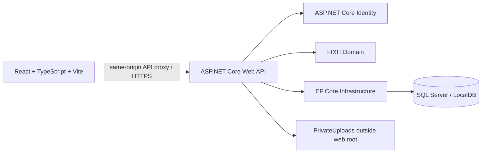
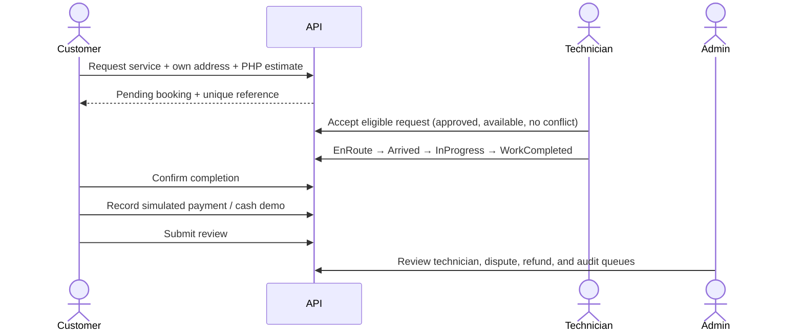
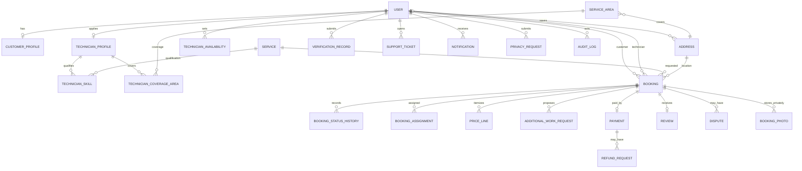

# FIXIT

**Fast In-home eXpert Installation and Technical Service** — “Home repairs, made easier.”

FIXIT is a Philippine home maintenance booking platform built as a college-project demonstration. It connects customers with technicians for appliance repairs, installation, and household maintenance. Prices are shown in PHP and schedules use Asia/Manila time.

The app includes a React customer site and role dashboards, an ASP.NET Core API, ASP.NET Core Identity, a SQL Server EF Core model/migration, simulated payment records, support/privacy workflows, and unit/API integration tests. It is not a production-ready payment or technician tracking service.

## Architecture



## Requirements

- .NET 10 SDK. Developed and built with SDK 10.0.113.
- SQL Server, SQL Server Express, or LocalDB for the primary migration workflow. This workspace also has a MySQL 8 runtime option for local development; it creates a separate `fixit_local` database from the EF model and leaves the SQL Server migration history intact.
- Node.js and npm. Frontend dependencies are locked in `frontend/package-lock.json`.
- `dotnet-ef` 10.0.13 (the global tool used to generate the migration).

Install the EF tool if it is not available:

```powershell
dotnet tool install --global dotnet-ef --version 10.0.13
```

## Configure and run

### Quick local start on this Windows workspace

MySQL is already running here. From the project directory, run:

```powershell
.\start-local.ps1
```

The script builds the solution, starts the API on port 5148 and frontend on port 5173, creates/uses the separate `fixit_local` database, and seeds fictional customer and technician accounts. It uses `MYSQL_HOST`, `MYSQL_PORT`, `MYSQL_USER`, and `MYSQL_PASSWORD` from the environment; if the username or password is missing, it prompts for them. The MySQL account needs permission to create a database and tables. Open <http://localhost:5173> when it reports ready. Use `demo.customer@fixit.test` or `demo.technician@fixit.test` with password `Fixit-Demo-2026!`. To stop both local services, run `.\stop-local.ps1` from the project directory. These are development demo credentials; do not use them in a deployment.

The MySQL option uses Oracle's EF Core 10 provider and EF `EnsureCreated` for a fresh local schema. It is a run-ready classroom path; the checked-in EF migrations and idempotent SQL deployment script target SQL Server. The primary SQL Server setup follows below.

Start a SQL Server instance and provide its connection string through environment configuration. Example for local SQL Server with Windows authentication:

```powershell
$env:ConnectionStrings__Fixit = 'Server=localhost;Database=FIXIT;Trusted_Connection=True;TrustServerCertificate=True'
```

Do not put real credentials in tracked files. For local SQL authentication, keep the connection string in .NET user-secrets or an untracked environment variable.

From the repository directory:

```powershell
dotnet restore FIXIT.slnx
dotnet ef database update --project FIXIT.Infrastructure --startup-project FIXIT.API
dotnet run --project FIXIT.API
```

To review or apply migrations through SQL Server Management Studio, generate the idempotent SQL Server script with:

```powershell
dotnet ef migrations script --idempotent --project FIXIT.Infrastructure --startup-project FIXIT.API --output Database/FIXIT_Migrations.sql
```

The checked-in [migration script](<Database/FIXIT_Migrations.sql>) was generated from the current EF migrations. Review and apply it to the intended database using SQL Server tooling.

The HTTP development profile listens on `http://localhost:5148`. `GET /health` does not need a database; service and account endpoints do. Swagger is available at `/swagger` in Development.

For deployment, publish the API and frontend separately or host the frontend through a same-origin reverse proxy. Route `/api` and `/health` to ASP.NET Core, enable HTTPS, configure allowed host names and SQL connection strings through deployment secrets, and grant the API process exclusive access to `PrivateUploads`. Never expose that directory as static content.

In a second terminal:

```powershell
cd frontend
npm ci
npm run dev
```

Open `http://localhost:5173`. Vite proxies `/api` and `/health` to the API on port 5148. Browser mutations use the API’s antiforgery token endpoint and same-origin cookie authentication.

### Create the first administrator

Set these values only in the local environment, then start the API. When both are set, FIXIT applies migrations, creates the administrator if absent, and assigns the Administrator role. The password must satisfy Identity’s configured password rules.

```powershell
$env:FIXIT_BOOTSTRAP_ADMIN_EMAIL = 'admin@example.test'
$env:FIXIT_BOOTSTRAP_ADMIN_PASSWORD = 'Use-A-Unique-Local-Password-123!'
dotnet run --project FIXIT.API
```

Unset the bootstrap values after setup. Public registration only accepts Customer or Technician roles. Technician accounts remain pending until an administrator reviews their application and a private verification document.

### Optional fictional demonstration accounts

For a local classroom walkthrough, opt in from the Development environment only. Set a password that satisfies Identity's rules; both fictional accounts use that local password. The seeder applies migrations and is idempotent: it creates one demo customer, one pre-approved demo technician, a Makati address, weekly availability, and three sample bookings with clearly simulated payment records. Never enable this option in a deployed environment.

```powershell
$env:FIXIT_SEED_DEMO_DATA = 'true'
$env:FIXIT_DEMO_PASSWORD = 'Choose-A-Unique-Demo-Password-123!'
dotnet run --project FIXIT.API
```

Sign in as `demo.customer@fixit.test` or `demo.technician@fixit.test`. Clear these environment variables after seeding. The sample names, phone numbers, address, and booking history are fictional.

## Role capabilities

| Role | Capabilities |
| --- | --- |
| Customer | Manage own addresses; browse services; request, view, reschedule, and cancel eligible bookings; approve extra work; confirm completion; record a demo payment; review jobs; submit disputes/support/privacy requests; export own account data. |
| Technician | Submit skills, coverage, and private verification files; manage weekly availability and online state; view eligible job summaries; accept jobs; see full customer/address details only for assigned jobs; update the job lifecycle; propose additional charges; review demo earnings; open disputes/support tickets. |
| Administrator | View platform metrics; review technicians and private verification documents; approve/reject technicians; search/suspend accounts; view/assign bookings; manage services/coverage; review disputes, support tickets, refunds, and reviews; process account deletion requests; inspect audit events. |

Admin APIs are server-protected by the Administrator role. Customer and assigned-technician resources are scoped to the authenticated account. Registration does not allow clients to choose Administrator.

## Main user flows



Booking assignment is done in a serializable transaction with a technician/time conflict check. New request offers go only to approved, online technicians whose recorded service skills, exact active coverage area, weekly availability, and schedule fit; offer lists apply the same filters. Customers receive booking confirmation, rescheduling, and cancellation notifications, and rescheduling an assigned job checks that technician's availability and schedule. The API checks service availability, configured coverage area, address ownership, price, and allowed status transitions. Additional-work charges are added only after customer approval. Booking status history records the acting user.

## Data model



The initial migration seeds the nine fictional service categories, sample PHP starting prices, four configurable service areas, and Customer/Technician/Administrator roles. Technician skills and coverage are normalized relationships to services and configured areas. Job matching, acceptance, and administrator assignment use those relationships. Optional, Development-only demo accounts and bookings are created at startup only when explicitly enabled; their password comes from the local environment and is never stored in source control.

## API overview

- `GET /health`, `GET /api/auth/csrf`
- `POST /api/auth/register|login|logout`, `GET /api/auth/me`
- `GET /api/services`, `GET /api/services/{id}`
- Customer: `/api/account`, `/api/addresses`, `/api/bookings`, `/api/payments`, `/api/privacy`, `/api/support`
- Technician: `/api/technician/application`, `/api/technician/verification`, `/api/technician/availability`, `/api/technician/jobs` (accept or persistently pass), `/api/technician/jobs/{id}/work-report`, `/api/technician/earnings`, `/api/technician/reviews`
- Administrator: `/api/admin/dashboard`, `/api/admin/users`, `/api/admin/administrators` (list/create with audit logging), `/api/admin/technicians`, `/api/admin/verification`, `/api/admin/bookings`, `/api/admin/services`, `/api/admin/areas`, `/api/admin/disputes`, `/api/admin/tickets`, `/api/admin/refunds`, `/api/admin/reviews`, `/api/admin/deletion-requests`, `/api/admin/audit`

See the controllers and Development Swagger for request/response schemas. ASP.NET validation enforces request constraints. Cookie-authenticated state changes require `X-XSRF-TOKEN` from `/api/auth/csrf`.

## Security, privacy, and limitations

- Identity hashes passwords. Cookies are HTTP-only, SameSite Strict, and Secure outside Development. Failed sign-in attempts are locked out. API requests have a rate limit, error responses are generic, and baseline security headers are applied.
- Role checks are performed by the API, not just the frontend. The API checks address/booking ownership and only returns technician contact/address details for assigned jobs.
- Technician verification documents and job photos are stored under `PrivateUploads` outside the static web root. Upload size and file signatures are checked; access is authorized per record. Back up and protect this folder along with the database.
- Demo payment records are marked simulated; no card gateway, real charge/refund, email, SMS, GPS, or live map is connected. Each finalized simulated payment snapshots the configured platform fee and technician net so later fee changes do not rewrite historical reports. Do not enter actual payment credentials or production personal data.
- Account export includes customer and technician records, payment/refund data, reviews, support/privacy requests, notifications, and uploaded-photo metadata scoped to the signed-in user; verification files and private storage paths are excluded. Approved deletion deactivates and anonymizes account/address fields while retaining booking-linked records that may be needed for financial/dispute history. Define and review retention periods before deployment.
- FIXIT is designed with the Philippine Data Privacy Act of 2012 (RA 10173) in mind, but it does not claim legal compliance. Obtain legal/privacy review, set a real privacy contact, and document a production incident-response and backup/recovery process before handling real customer data.
- Remaining production work includes SQL Server provisioning and deployment, email verification/password recovery, stronger file malware scanning/encryption and retention automation, formal policy configuration, load/concurrency testing against SQL Server, and full accessibility/security review. No precise GPS tracking is implemented.

## Tests and actual verification

Run from the root after dependencies are installed:

```powershell
dotnet build FIXIT.slnx
dotnet test FIXIT.slnx
cd frontend
npm ci
npm run build
npm test
```

Verified in this environment:

- `dotnet build FIXIT.slnx`: passed, 0 warnings and 0 errors.
- `dotnet test FIXIT.slnx`: backend unit and API integration tests passed (16 total); integration tests use EF InMemory and verify health, seeded services and demo accounts/bookings, customer booking creation/server pricing/rescheduling/cancellation and notifications, customer and technician privacy exports, technician skill/coverage applications, offer acceptance and passing, repair reports, customer-visible feedback, payment fee snapshots and earnings, duplicate refund prevention/refund finalization, refunded-payment recapture rejection, administrator creation/roster, registration, ownership scoping, administrator-route denial, and protection against reassigning completed bookings.
- `npm run build`: passed with Vite/TypeScript.
- `npm test`: passed, 2 Vitest UI tests.
- API smoke check: `/health` returned FIXIT and Asia/Manila.
- Live development smoke check: frontend returned HTTP 200 with the FIXIT page title, and its `/health` proxy returned `ok`.
- SQL Server EF migrations were generated against the current model. `dotnet ef database update` was not run because SQL Server/LocalDB is not installed. SQL provider behavior, serializable isolation, and migration application still need verification on SQL Server. The EF InMemory provider ignores transaction semantics in tests.
- `Database/FIXIT_Migrations.sql`: idempotent SQL Server migration script generated successfully from all checked-in migrations; it has not been executed in this environment.
- `dotnet ef migrations has-pending-model-changes`: passed; no model changes are missing from the migration.

## Functional and non-functional requirements

- **Accounts:** register and authenticate, change password, edit contact profile, request privacy export/deletion, and apply for technician access.
- **Services and addresses:** browse active services/estimates; save Philippine region, province, city, barangay and street; validate service area and address ownership on booking creation.
- **Bookings:** request, view, cancel/reschedule within configured cutoff, track status history, review completed work, open support/dispute requests, and view cost/payment records.
- **Technicians:** select service categories and configured coverage areas and submit verification documents; set weekly availability; go online; view privacy-limited, skill- and area-matched offers; accept conflict-free jobs or pass on offers; update job status; record repair notes and parts used; submit photos and extra-work charges; review customer ratings and comments; see demo earnings.
- **Administration:** view database metrics; review technician applications and private files; manage users and administrator accounts, assignments, services, areas, fees and policy cutoff; review refunds, disputes, support tickets, privacy requests and reviews; inspect audit events.
- **Quality:** responsive React pages, server validation and ownership authorization, identity password hashing, cookie/CSRF controls, rate limits, private uploads, meaningful loading/error/empty messages, and auditable sensitive decisions.

### Use cases

1. **Customer books a repair.** The API checks that the selected address belongs to the customer, the service is active, the city is covered, the requested date is eligible, and the server price is used. It records a pending booking, unique reference, itemized base-price line and pending demo payment.
2. **Technician accepts and completes work.** An approved online technician with a matching city and weekly slot sees only a limited request summary. A serializable transaction checks the assignment and schedule conflict. The assigned technician progresses the job; additional charges remain pending until customer approval.
3. **Customer closes the job.** After technician completion, the customer confirms the work, records a clearly simulated payment/cash demo entry, and submits one review. No real money is captured.
4. **Administrator reviews a technician.** The administrator inspects an application and private verification file, records a reason, and can approve only after application details and at least one verification record are approved.
5. **Customer requests privacy action.** The customer exports account-linked details or requests deletion. An administrator records the decision. Approved deletion deactivates and anonymizes account/address fields; booking links are retained for financial/dispute history.

### Non-functional requirements

- PHP currency, Philippine mobile-number validation, Philippine address fields, and UTC database timestamps with Asia/Manila scheduling/availability.
- Role and resource checks happen in the API. The browser cannot provide trusted user IDs or administrator privileges.
- Unique booking references and database indexes support the primary account, schedule, service, review, notification, payment, and audit lookups.
- External payment, email, SMS, GPS and maps are not represented as connected services. Demo receipts and payment records are labeled simulated.

## Database backup and recovery

Use SQL Server’s normal full-backup and restore process and include the `PrivateUploads` directory in a separate protected backup. Keep database and upload backups access-controlled, encrypted at rest, and on a schedule appropriate to the deployment. Test restores to a non-production SQL instance before relying on them.

```sql
BACKUP DATABASE [FIXIT]
TO DISK = N'D:\SqlBackups\FIXIT_full.bak'
WITH INIT, CHECKSUM, STATS = 10;

RESTORE VERIFYONLY
FROM DISK = N'D:\SqlBackups\FIXIT_full.bak'
WITH CHECKSUM;
```

For recovery, stop application writes, restore the database and matching private uploads, validate the migration level and sample bookings, then restart the API. Never restore customer data into a public/demo environment without authorization and data minimization.

## Scope and legal review

FIXIT is designed with the Philippine Data Privacy Act of 2012 (RA 10173) in mind, but it does not claim legal compliance. Before real deployment, define retention and incident-response timelines, configure a real privacy contact, review third-party disclosures, obtain legal/privacy review, scan files for malware, and verify encryption/access controls for identity documents and home photos. This school demonstration does not have live GPS, real payment, messaging integrations, automated backups, or a production security review.

## Project status

Core demo flows and dashboards are implemented. This remains an educational demonstration; the limitations above are part of the project scope. `FIXIT` is the system name and Fast In-home eXpert Installation and Technical Service is its official expansion.
